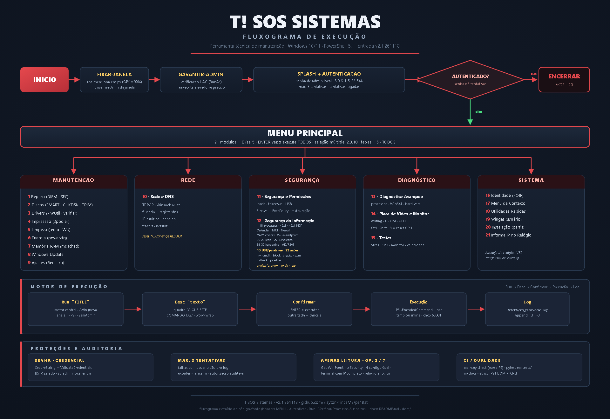

# T! SOS Sistemas — Ferramenta Técnica de Manutenção

> **EN:** Interactive Windows maintenance toolkit (PowerShell 5.1) — a single-script menu tool with 21 maintenance, diagnostic and security modules.
> **PT:** Ferramenta interativa de manutenção para Windows (PowerShell 5.1) — script único com menu de 21 módulos de manutenção, diagnóstico e segurança.
> **EN:** Every menu accepts multi-select: type `2,3,10`, ranges like `1-3`, `TODOS`, or press ENTER to run all options in sequence (`0` goes back).
> **PT:** Todos os menus aceitam seleção múltipla: digite `2,3,10`, intervalos como `1-3`, `TODOS` ou pressione ENTER para executar todas as opções em sequência (`0` volta).

Versão atual: **v2.1.261118**.

## Fluxograma de execução



Do `INÍCIO` ao despacho dos 21 menus: fixagem da janela, elevação UAC, autenticação
(SID `S-1-5-32-544`, máx. 3 tentativas), menu principal com multi-seleção, os 5 grupos de
módulos, o motor de execução (`Run → Desc → Confirmar → Execução → Log`) e as
proteções/auditoria. Vetor editável em [`docs/assets/fluxograma.svg`](docs/assets/fluxograma.svg).

## Requisitos

- Windows com PowerShell 5.1 ou superior (sintaxe mantida compatível com 5.1).
- Conta com privilégios de **Administrador**.
- Para o menu 8 (Windows Update): módulo `PSWindowsUpdate` (instalado pelo próprio menu).

## Como executar

```powershell
powershell -NoProfile -ExecutionPolicy Bypass -File SOS-Manutencao.ps1
```

Ou clique com o botão direito em `SOS-Manutencao.ps1` → **Executar como Administrador**.

Na inicialização, a ordem é fixa:

1. `Garantir-Admin` — auto-elevação via UAC, se necessário.
2. `Autenticar` — valida a senha do administrador local (até 3 tentativas).
3. `Menu-Principal` — exibe o menu interativo.

## Menus

| Nº | Menu | Ferramentas principais |
|----|------|------------------------|
| 1 | Reparo e Integridade do Sistema | DISM, SFC |
| 2 | Discos e Armazenamento | SMART, CHKDSK, Optimize, TRIM |
| 3 | Drivers | PnPUtil |
| 4 | Impressão e Spooler | spooler, `printui`, `Get-Printer` |
| 5 | Limpeza e Manutenção | pastas Temp, `cleanmgr`, cache do Windows Update |
| 6 | Energia e Desempenho | `powercfg` + relatórios HTML |
| 7 | Memória RAM | `mdsched`, WinSAT, `wmic` |
| 8 | Atualização do Windows | módulo `PSWindowsUpdate` |
| 9 | Ajustes de Desempenho | Registro do Windows |
| 10 | Rede e DNS | reset TCP/IP/Winsock, flush DNS, `tracert`, IP estático |
| 11 | Segurança e Permissões | ICACLS, `takeown`, USB, Firewall, Execution Policy |
| 12 | Segurança da Informação | auditoria de eventos, antivírus (Defender, MRT), RDP, usuários/permissões, rede/superfície de ataque, persistência, hardening, drives USB/pendrives |
| 13 | Diagnóstico Avançado | processos, eventos, boot/reboot, WinSAT, hardware, `wmic` |
| 14 | Placa de Vídeo e Monitor | `dxdiag`, DCOM, GPU |
| 15 | Testes | CPU, velocidade, monitor |
| 16 | Identidade do Sistema | renomear PC, nome de conta local, IP estático |
| 17 | Menu de Contexto | clássico Win11, atalhos T! SOS no desktop |
| 18 | Utilidades Rápidas | ping, msinfo32, msconfig, calc, regedit |
| 19 | Winget | gerenciador de pacotes (**roda em contexto não-elevado**) |
| 20 | Instalação de Programas | Winget: comum, avançado, desenvolvimento |
| 21 | Informe IP no Relógio do Windows | IP na bandeja via registro + VBS persistente + tarefa agendada `kbp_atualiza_ip` |

Detalhes em [`docs/menus.md`](docs/menus.md) — ou rode localmente (ver abaixo).

## Segurança e log

- Autenticação obrigatória com a senha do administrador local ao iniciar.
- Todas as ações privilegiadas são registradas em `%TEMP%\SOS_Manutencao.log`.
- O Winget (menu 19) sempre executa em contexto de **usuário comum** (requisito do gerenciador).

## Estrutura do repositório

```text
SOS-Manutencao.ps1              # único script; toda a lógica em funções Menu-*
docs/                # documentação MkDocs (inclui assets/fluxograma.svg|png)
mkdocs.yml           # configuração do MkDocs
requirements-docs.txt# dependência da documentação (mkdocs)
README.md
LICENSE
```

## Documentação completa

- Índice da documentação: https://github.com/klaytonPrinceMS/ps1Bat/tree/main/docs
- Fluxograma de execução (SVG vetorial): https://github.com/klaytonPrinceMS/ps1Bat/blob/main/docs/assets/fluxograma.svg
- Uso (execução, autenticação, log): https://github.com/klaytonPrinceMS/ps1Bat/blob/main/docs/uso.md
- Referência dos 21 menus: https://github.com/klaytonPrinceMS/ps1Bat/blob/main/docs/menus.md
- Desenvolvimento (código, testes, versionamento): https://github.com/klaytonPrinceMS/ps1Bat/blob/main/docs/desenvolvimento.md
- Site MkDocs: https://klaytonprincems.github.io/ps1Bat/ (ative em Settings → Pages → Source: GitHub Actions; o workflow `docs` publica a cada push)

## Documentação (MkDocs)

Pré-requisito: Python 3 com pip.

```powershell
pip install -r requirements-docs.txt
mkdocs serve      # preview em http://127.0.0.1:8000
mkdocs build --strict   # gera site/ (ignorado pelo git)
```

## Licença

MIT — ver `LICENSE`.
