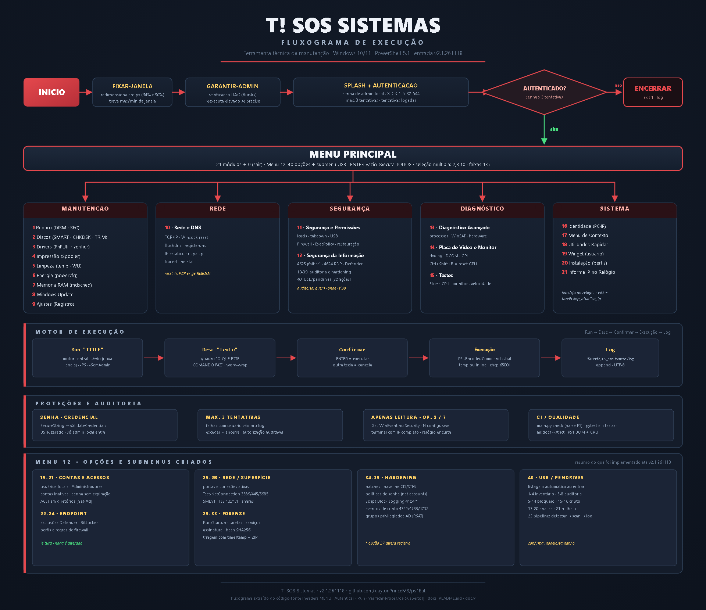

# T! SOS Sistemas — Ferramenta Técnica de Manutenção

> **EN:** Interactive Windows maintenance toolkit by T! SOS Sistemas. Current version **v2.1.261118**, single script: `SOS-Manutencao.ps1` (PowerShell 5.1).
> **PT:** Ferramenta interativa de manutenção para Windows do T! SOS Sistemas. Versão atual **v2.1.261118**, script único: `SOS-Manutencao.ps1` (PowerShell 5.1).

Toda a lógica vive em funções `Menu-*` despachadas pelo `Menu-Principal`.
O comentário de cabeçalho do `SOS-Manutencao.ps1` (linhas 1–36) é a lista oficial de
funcionalidades.

## Fluxograma de execução



Cadeia completa: `INÍCIO → Fixar-Janela → Garantir-Admin (UAC) → SPLASH + Autenticação
(SID S-1-5-32-544, máx. 3 tentativas) → AUTENTICADO? → Menu-Principal`. Abaixo dela, os
21 módulos em 5 grupos (Manutenção 1–9 · Rede 10 · Segurança 11–12 · Diagnóstico 13–15 ·
Sistema 16–21), o motor de execução (`Run → Desc → Confirmar → Execução → Log`, log em
`%TEMP%\SOS_Manutencao.log`) e as proteções/auditoria. A seção final resume as
opções e submenus criados no Menu 12: contas/endpoint (19–24),
rede/forense (25–33), hardening (34–39) e o submenu de USB/pendrives
(opção 40, com 22 ações). O vetor editável fica em
`docs/assets/fluxograma.svg` (neste site: [assets/fluxograma.svg](assets/fluxograma.svg)).

O Menu 12 inclui o submenu de **drives USB e pendrives** (opção 40): ao entrar,
lista discos USB e volumes removíveis automaticamente e oferece 22 ações de
inventário, auditoria, bloqueio, criptografia, análise e higienização, com
confirmação de modelo/tamanho e rollback dos bloqueios.

## Início rápido

```powershell
powershell -NoProfile -ExecutionPolicy Bypass -File SOS-Manutencao.ps1
```

1. `Fixar-Janela` dimensiona a janela em pixels (94% x 90% da área útil do
   monitor, pela fonte atual) e trava os botões maximizar/minimizar.
2. `Garantir-Admin` eleva via UAC se necessário.
3. `Autenticar` exibe a caveira com data/hora e valida a senha do administrador
   local (máx. 3 tentativas, via `PrincipalContext` contra o SAM local).
4. `Menu-Principal` exibe as opções 1–21.

Todas as ações privilegiadas são registradas em
`%TEMP%\SOS_Manutencao.log` (função `Log`).
